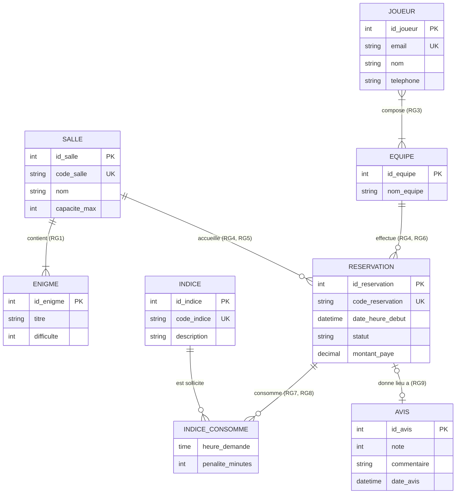

# Conception de la Base de Données : Escape Game

Ce document rassemble l'ensemble de la démarche de conception pour le système de réservation et de suivi des sessions d'Escape Game : cahier des charges, modèle conceptuel (MCD), modèle logique (MLD) sous PostgreSQL et gestion des contraintes d'intégrité métier.

---

## 1. Cahier des charges

### 1.1 Règles de gestion (RG)

* **RG1** : Une salle propose au moins une énigme, et chaque énigme appartient à exactement une salle.
* **RG2** : Un joueur s'inscrit avec au plus un compte, et un compte appartient à exactement un joueur.
* **RG3** : Une équipe est composée d'au moins deux et d'au plus six joueurs.
* **RG4** : Une réservation concerne exactement une salle et est effectuée par exactement une équipe.
* **RG5** : Un créneau horaire dans une salle donnée fait l'objet d'au plus une réservation confirmée.
* **RG6** : Une équipe peut réserver au moins une session ou n'en avoir encore aucune (facultatif).
* **RG7** : Durant une session, une équipe peut demander au moins zéro et au plus dix indices.
* **RG8** : L'association entre une réservation et un indice consommé porte toujours l'heure précise de demande et le temps de pénalité accordé (association porteuse de données).
* **RG9** : Une équipe peut déposer au plus un avis à l'issue de sa session, qui porte toujours une note de 1 à 5 et un commentaire (association porteuse de données).
* **RG10** : Une réservation possède toujours un statut (en attente, confirmée, terminée, annulée) et un montant total payé.

### 1.2 Questions posées et réponses retenues

Lors de la modélisation du domaine métier, plusieurs arbitrages ont été tranchés :

* **Une équipe peut-elle exister sans avoir encore réservé ?**
  * *Réponse retenue* : Oui. Une équipe peut se constituer en ligne en prévision d'une sortie avant même de sélectionner un créneau (cardinalité `0,N` sur la réservation côté équipe, RG6).
* **Une salle peut-elle exister sans énigme configurée ?**
  * *Réponse retenue* : Non. Pour être réservable et cohérente dans le catalogue, une salle doit obligatoirement proposer au moins une énigme (cardinalité `1,N` côté salle vers énigme, RG1).
* **Un joueur peut-il appartenir à plusieurs équipes ?**
  * *Réponse retenue* : Oui. Un utilisateur peut jouer avec ses collègues de travail un jour, et avec sa famille un autre jour. La relation entre joueur et équipe est donc plusieurs-à-plusieurs (`N,N`).
* **L'indice consommé est-il rattaché à l'équipe ou à la réservation ?**
  * *Réponse retenue* : À la réservation. Si une même équipe joue plusieurs sessions différentes dans l'année, les indices consommés et leurs pénalités appartiennent à une session précise et non à l'équipe de manière globale.
* **Un avis peut-il être déposé de façon anonyme ou sans session ?**
  * *Réponse retenue* : Non. Un avis est strictement lié à une réservation unique et terminée (`0,1` vers `1,1`), afin d'éviter les faux avis et de garantir que seuls les joueurs ayant réservé puissent évaluer la salle.
* **Le prix payé et les pénalités doivent-ils être recalculés ou figés ?**
  * *Réponse retenue* : Ils doivent être figés et scellés. Le tarif des créneaux et les barèmes de pénalité pouvant évoluer dans le temps, la réservation et la consommation d'indices doivent conserver les valeurs exactes appliquées au moment des faits.

---

## 2. Modèle Conceptuel de Données (MCD)

### 2.1 Diagramme Entité-Association (Mermaid)

### 2.2 Entités et identifiants

Chaque entité dispose d'un identifiant technique entier ainsi que d'un identifiant métier stable lorsqu'il existe :

* **`SALLE`** : Identifiant technique `id_salle`, identifiant métier `code_salle` (ex: `SALLE-AZTEC`).
* **`ENIGME`** : Identifiant technique `id_enigme`.
* **`JOUEUR`** : Identifiant technique `id_joueur`, identifiant métier `email` unique (RG2).
* **`EQUIPE`** : Identifiant technique `id_equipe`.
* **`RESERVATION`** : Identifiant technique `id_reservation`, identifiant métier `code_reservation` unique (ex: `RES-2026-0042`).
* **`INDICE`** : Identifiant technique `id_indice`, identifiant métier `code_indice` unique (ex: `IND-AZTEC-01`).
* **`AVIS`** : Identifiant technique `id_avis`.

### 2.3 Associations et cardinalités appuyées sur les règles

* **SALLE - ENIGME (`contient`)** :
  * `SALLE` vers `ENIGME` : `1,N` (Une salle propose au moins une énigme, RG1).
  * `ENIGME` vers `SALLE` : `1,1` (Chaque énigme appartient à exactement une salle, RG1).
* **JOUEUR - EQUIPE (`compose`)** :
  * `JOUEUR` vers `EQUIPE` : `1,N` (Un joueur peut faire partie d'une ou plusieurs équipes).
  * `EQUIPE` vers `JOUEUR` : `2,6` (Une équipe comporte entre 2 et 6 joueurs, RG3).
* **SALLE - RESERVATION (`accueille`)** :
  * `SALLE` vers `RESERVATION` : `0,N` (Une salle accueille plusieurs réservations au fil de l'eau).
  * `RESERVATION` vers `SALLE` : `1,1` (Une réservation concerne exactement une salle, RG4).
* **EQUIPE - RESERVATION (`effectue`)** :
  * `EQUIPE` vers `RESERVATION` : `0,N` (Une équipe peut réserver des sessions ou aucune, RG6).
  * `RESERVATION` vers `EQUIPE` : `1,1` (Une réservation est effectuée par exactement une équipe, RG4).
* **RESERVATION - INDICE (`consomme`)** :
  * `RESERVATION` vers `INDICE` : `0,10` (Entre 0 et 10 indices par session, RG7).
  * `INDICE` vers `RESERVATION` : `0,N` (Un indice peut être demandé lors de multiples sessions).
* **RESERVATION - AVIS (`donne lieu a`)** :
  * `RESERVATION` vers `AVIS` : `0,1` (Au plus un avis par session terminée, RG9).
  * `AVIS` vers `RESERVATION` : `1,1` (Un avis est lié à exactement une réservation, RG9).

### 2.4 Associations porteuses de données

Le modèle comporte deux associations porteuses de données :
1. **`INDICE_CONSOMME`** (entre `RESERVATION` et `INDICE`) : porte `heure_demande` (moment exact de la demande) et `penalite_minutes` (temps ajouté au chronomètre de la session), conformément à la règle RG8.
2. **`AVIS` / `donne lieu a`** : modélisé comme entité liée à la réservation (`0,1` vers `1,1`), porte la `note` (1 à 5), le `commentaire` et la date du dépôt (RG9).

---

## 3. Modèle Logique de Données (MLD) - PostgreSQL

### 3.1 Schéma relationnel textuel

* **`salle`** (
  **`id_salle`** INT GENERATED ALWAYS AS IDENTITY,
  `code_salle` VARCHAR(30) NOT NULL UNIQUE,
  `nom` VARCHAR(100) NOT NULL,
  `capacite_max` INT NOT NULL,
  CONSTRAINT `pk_salle` PRIMARY KEY (`id_salle`),
  CONSTRAINT `chk_capacite` CHECK (`capacite_max` >= 2)
  )

* **`enigme`** (
  **`id_enigme`** INT GENERATED ALWAYS AS IDENTITY,
  `titre` VARCHAR(120) NOT NULL,
  `difficulte` INT NOT NULL,
  *`id_salle`* INT NOT NULL,
  CONSTRAINT `pk_enigme` PRIMARY KEY (`id_enigme`),
  CONSTRAINT `fk_enigme_salle` FOREIGN KEY (`id_salle`) REFERENCES `salle`(`id_salle`) ON DELETE CASCADE,
  CONSTRAINT `chk_difficulte` CHECK (`difficulte` BETWEEN 1 AND 5)
  )

* **`joueur`** (
  **`id_joueur`** INT GENERATED ALWAYS AS IDENTITY,
  `email` VARCHAR(255) NOT NULL UNIQUE,
  `nom` VARCHAR(100) NOT NULL,
  `telephone` VARCHAR(30),
  CONSTRAINT `pk_joueur` PRIMARY KEY (`id_joueur`)
  )

* **`equipe`** (
  **`id_equipe`** INT GENERATED ALWAYS AS IDENTITY,
  `nom_equipe` VARCHAR(100) NOT NULL,
  CONSTRAINT `pk_equipe` PRIMARY KEY (`id_equipe`)
  )

* **`composition_equipe`** (
  ***`id_equipe`*** INT NOT NULL,
  ***`id_joueur`*** INT NOT NULL,
  `date_adhesion` DATE DEFAULT CURRENT_DATE,
  CONSTRAINT `pk_composition_equipe` PRIMARY KEY (`id_equipe`, `id_joueur`),
  CONSTRAINT `fk_compo_equipe` FOREIGN KEY (`id_equipe`) REFERENCES `equipe`(`id_equipe`) ON DELETE CASCADE,
  CONSTRAINT `fk_compo_joueur` FOREIGN KEY (`id_joueur`) REFERENCES `joueur`(`id_joueur`) ON DELETE RESTRICT
  )

* **`indice`** (
  **`id_indice`** INT GENERATED ALWAYS AS IDENTITY,
  `code_indice` VARCHAR(30) NOT NULL UNIQUE,
  `description` TEXT NOT NULL,
  CONSTRAINT `pk_indice` PRIMARY KEY (`id_indice`)
  )

* **`reservation`** (
  **`id_reservation`** INT GENERATED ALWAYS AS IDENTITY,
  `code_reservation` VARCHAR(30) NOT NULL UNIQUE,
  `date_heure_debut` TIMESTAMP NOT NULL,
  `statut` VARCHAR(20) NOT NULL,
  `montant_paye` NUMERIC(8, 2) NOT NULL,
  *`id_salle`* INT NOT NULL,
  *`id_equipe`* INT NOT NULL,
  CONSTRAINT `pk_reservation` PRIMARY KEY (`id_reservation`),
  CONSTRAINT `fk_res_salle` FOREIGN KEY (`id_salle`) REFERENCES `salle`(`id_salle`) ON DELETE RESTRICT,
  CONSTRAINT `fk_res_equipe` FOREIGN KEY (`id_equipe`) REFERENCES `equipe`(`id_equipe`) ON DELETE RESTRICT,
  CONSTRAINT `uk_salle_creneau` UNIQUE (`id_salle`, `date_heure_debut`),
  CONSTRAINT `chk_statut` CHECK (`statut` IN ('EN_ATTENTE', 'CONFIRMEE', 'TERMINEE', 'ANNULEE')),
  CONSTRAINT `chk_montant` CHECK (`montant_paye` >= 0)
  )

* **`indice_consomme`** (
  ***`id_reservation`*** INT NOT NULL,
  ***`id_indice`*** INT NOT NULL,
  `heure_demande` TIME NOT NULL,
  `penalite_minutes` INT NOT NULL DEFAULT 3,
  CONSTRAINT `pk_indice_consomme` PRIMARY KEY (`id_reservation`, `id_indice`),
  CONSTRAINT `fk_consomme_res` FOREIGN KEY (`id_reservation`) REFERENCES `reservation`(`id_reservation`) ON DELETE CASCADE,
  CONSTRAINT `fk_consomme_indice` FOREIGN KEY (`id_indice`) REFERENCES `indice`(`id_indice`) ON DELETE RESTRICT
  )

* **`avis`** (
  **`id_avis`** INT GENERATED ALWAYS AS IDENTITY,
  *`id_reservation`* INT NOT NULL UNIQUE,
  `note` INT NOT NULL,
  `commentaire` TEXT,
  `date_avis` TIMESTAMP DEFAULT CURRENT_TIMESTAMP,
  CONSTRAINT `pk_avis` PRIMARY KEY (`id_avis`),
  CONSTRAINT `fk_avis_reservation` FOREIGN KEY (`id_reservation`) REFERENCES `reservation`(`id_reservation`) ON DELETE CASCADE,
  CONSTRAINT `chk_note` CHECK (`note` BETWEEN 1 AND 5)
  )

### 3.2 Rangement des associations du MCD (Règles de passage)

| Association MCD | Entités reliées | Cardinalités | Traduction dans le MLD | Justification / Règle de passage |
| :--- | :--- | :--- | :--- | :--- |
| **contient** (RG1) | `SALLE` - `ENIGME` | `1,N` – `1,1` | Clé étrangère `id_salle` dans `enigme` | Relation `1,1` côté `enigme` : la clé primaire de `salle` migre côté `enigme`. |
| **compose** (RG3) | `JOUEUR` - `EQUIPE` | `1,N` – `2,N` | Table de liaison `composition_equipe` | Relation `N,N` : création d'une table dédiée dont la clé primaire est composite `(id_equipe, id_joueur)`. |
| **accueille / effectue** (RG4, RG5, RG6) | `SALLE` - `EQUIPE` - `RESERVATION` | `1,N` – `0,N` – `1,1` | Clés étrangères `id_salle` et `id_equipe` dans `reservation` | Une réservation représente l'occurrence du créneau (`1,1` vers chaque parent) : les deux identifiants migrent dans `reservation`. |
| **consomme** (RG7, RG8) | `RESERVATION` - `INDICE` | `0,N` – `0,N` | Table de liaison porteuse `indice_consomme` | Relation `N,N` porteuse d'attributs (`heure_demande`, `penalite_minutes`). Clé primaire composite `(id_reservation, id_indice)`. |
| **donne lieu a** (RG9) | `RESERVATION` - `AVIS` | `0,1` – `1,1` | Clé étrangère unique `id_reservation` dans `avis` | Relation `0,1` vers `1,1` : `avis` stocke la clé étrangère `id_reservation` avec contrainte `UNIQUE` (au plus un avis par réservation). |

### 3.3 Données scellées et dénormalisation intentionnelle

* **`montant_paye` dans `reservation` (RG10)** :
  * *Donnée stockée* : Valeur exacte réglée par le client lors de la validation.
  * *Raison du scellement* : Les tarifs des salles pouvant être revalorisés ou soumis à des promotions saisonnières, le montant facturé doit rester historisé et immuable d'un point de vue comptable.
  * *Gouvernance* : Champ écrit une seule fois à la commande, non modifiable par la suite.
* **`penalite_minutes` dans `indice_consomme` (RG8)** :
  * *Donnée stockée* : Pénalité effective en minutes appliquée au chronomètre de la session.
  * *Raison du scellement* : Si la pénalité standard d'un indice est modifiée ultérieurement par les concepteurs du jeu, les classements et scores des sessions passées ne doivent pas être modifiés.
  * *Gouvernance* : Valeur copiée depuis la configuration par défaut à l'instant de la distribution de l'indice.

---

## 4. Ce que le schéma SQL ne garantit pas (et où on le garantit)

Le schéma relationnel garantit l'intégrité référentielle, le typage, les plages de valeurs fixes (`CHECK`) et l'unicité de réservation d'une salle par créneau (`UNIQUE(id_salle, date_heure_debut)`). En revanche, certaines règles métier complexes nécessitent des mécanismes complémentaires :

| Contrainte métier non garantie par le DDL | Règle | Raison de la limitation DDL | Emplacement et mécanisme de garantie |
| :--- | :--- | :--- | :--- |
| **Taille minimale de l'équipe (au moins 2 joueurs)** | RG3 | Une table de liaison `composition_equipe` ne peut pas exiger par une contrainte de colonne qu'au moins deux lignes existent avant insertion. | **Transaction applicative + Déclencheur (Trigger)** : L'application insère l'équipe et ses membres dans une même transaction. Un trigger PostgreSQL (`AFTER COMMIT` ou fonction de validation de session) bloque la réservation si le compte de joueurs est inférieur à 2. |
| **Plafond maximal de 6 joueurs par équipe** | RG3 | Une contrainte de table standard ne permet pas d'agréger le nombre de lignes associées à une clé étrangère lors de l'insertion. | **Trigger PostgreSQL `BEFORE INSERT`** sur `composition_equipe` : compte le nombre de membres existants pour `NEW.id_equipe` et lève une exception (`RAISE EXCEPTION`) si le quota de 6 est atteint. |
| **Plafond de 10 indices maximum par session** | RG7 | Une contrainte déclarative SQL locale ne peut pas limiter le nombre d'enregistrements fils rattachés à un parent. | **Trigger PostgreSQL `BEFORE INSERT`** sur `indice_consomme` : vérifie que `COUNT(*) < 10` pour la réservation avant d'autoriser l'insertion de l'indice. |
| **Chronologie de la demande d'indice** | Métier | L'heure de demande de l'indice doit être comprise dans la tranche horaire de la session de jeu (durée d'une heure). | **Contrôle dans l'API du Game Master / Trigger SQL** comparant `heure_demande` à l'intervalle `[date_heure_debut, date_heure_debut + INTERVAL '1 hour']`. |

